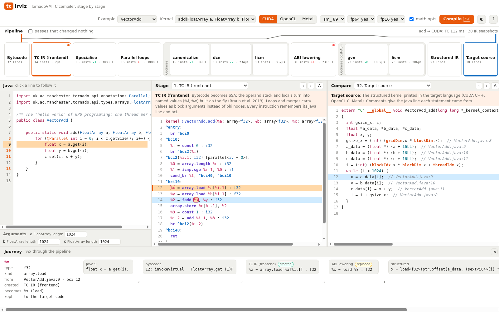
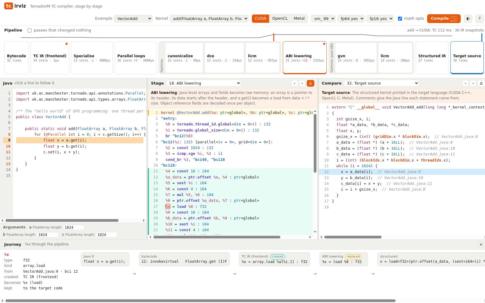
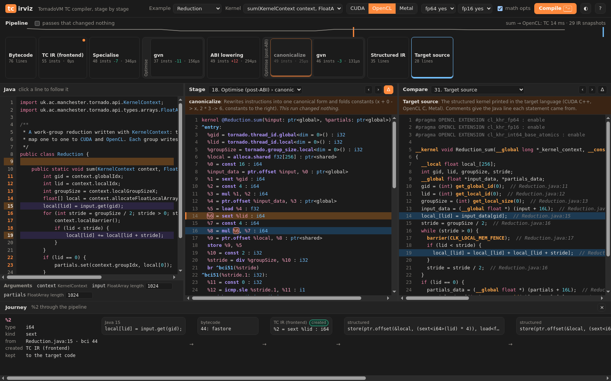

# tcirviz

An interactive explorer for **TC**, TornadoVM's kernel compiler. Type a Java kernel and watch
it become GPU code, one stage at a time. You can follow any line, bytecode or IR value through
every stage to the CUDA, OpenCL or Metal statement it ends up in.

```
tornado --tcirviz [MyKernels.java]
```

It opens `http://127.0.0.1:7878/` in the browser. Compilation is headless, so no GPU is needed.



## What it shows

| | |
|---|---|
| **Java** | An editor with eight examples. Lines that reach the generated code are marked in the gutter. |
| **Bytecode** | What `javac` produced, with each bytecode index (bci) tied to its Java line. |
| **TC IR** | Shown after every pipeline stage (frontend, inline, specialise, parallel loops, legality, ABI lowering, ...) and after **every optimisation pass** (canonicalize, cfg-simplify, dce, unroll, gvn, licm, math-peepholes), with the IR size and time of each. |
| **Structured IR** | The kernel after SSA destruction and control-flow structuring: if/while/break, still target-neutral. |
| **Target code** | CUDA C++, OpenCL C or Metal Shading Language, exactly as the TornadoVM runtime would install it. |

**Follow anything.** Click a Java line, a bytecode, an IR value (`%x`) or a line of target code:
- Every pane highlights what belongs to it: the lines that define it, the lines that use it, and the lines from the same Java line.
- The **Journey** bar lists its path. It says where the value is created, which pass changes it, and which one removes or *replaces* it (ABI lowering turns `%x = array.load` into `%x = load`; the trail continues). It ends at the target-code lines that use it.

**Diff any stage.** Δ marks what a stage or pass added, changed or removed against the previous one.
Lines are matched by instruction identity, not by text.

**See the control flow.** ⧉ draws the IR as a control-flow graph:
- blocks are boxes;
- branches are arrows, with the true and false edges of `cond_br` labelled T and F;
- loop back-edges are drawn in orange.

Combined with Δ, it shows what a pass did to the graph.

**Open a real application.** `tornado --tcirviz --params "--classpath app.jar --sourcepath src/main/java"`
adds *Open class…*, which lists the application's classes and opens their kernel methods. Sources
are also found in a `*-sources.jar` next to the jar. Without sources, the class file itself is
compiled. For example, GPULlama3's `TransformerComputeKernelsLayered` (50 kernels) opens with its
source, and 48 of its kernels compile under the default argument sizes. The other two report
TC-E4014: their local arrays exceed the 48 KB of shared memory at those sizes.

**Learn as you go.** Each stage and pass has a one-paragraph explanation, and hovering an opcode
explains it. Values show their type, origin (Java line and bci), and where they are created and
removed.

**Specialise like the runtime.** TornadoVM compiles every task for its actual arguments. The
*Arguments* row sets array lengths, scalar values and object sizes, so you can see constant loop
bounds and folded sizes appear. Object arguments such as `Matrix2DFloat` are built for real, and
their device layouts come from the runtime's own `FieldLayout`, exactly as when a kernel runs.

**Targets.** Switch between CUDA (with the compute capability, fp64 and fp16 as options), OpenCL and
Metal. See [docs/architecture.md](docs/architecture.md) for adding a target.

| | |
|---|---|
|  |  |

## Install

You need a TornadoVM SDK built from `mikepapadim/tornadovm-compiler` (branch `compiler/main`, with
`TcTrace`), and JDK 21 or newer.

```bash
source ~/tornadovm-compiler/setvars.sh      # TORNADOVM_HOME, JAVA_HOME
./install.sh                                # builds build/tcirviz.jar and copies it into the SDK
tornado --tcirviz                           # or: tornado --tcirviz MyKernels.java
tornado --tcirviz --params "--port 9000 --no-open"
```

Without the launcher, run `bin/tcirviz [File.java] [--port N] [--no-open]`. To print the trace as
JSON for scripts, run `bin/tcirviz --json File.java [--method m] [--backend cuda|opencl|metal]`.

### With `java` and the SDK's argfile

The SDK's `tornado-argfile` holds the JVM options a TornadoVM application runs with (module path,
`--enable-preview`, native access). tcirviz runs with it like any other TornadoVM program, which is
how to start it from an IDE run configuration or a script with no Python launcher:

```bash
source ~/tornadovm-compiler/setvars.sh
TCIRVIZ=$TORNADOVM_HOME/share/java/tcirviz/tcirviz.jar          # after ./install.sh (or build/tcirviz.jar)

# the UI, on an example or your own kernels
java @"$TORNADOVM_HOME/tornado-argfile" -cp "$TCIRVIZ" io.github.mikepapadim.tcirviz.TcIrViz
java @"$TORNADOVM_HOME/tornado-argfile" -cp "$TCIRVIZ" io.github.mikepapadim.tcirviz.TcIrViz MyKernels.java --port 9000

# open a real application's kernels (Open class…), with its sources
java @"$TORNADOVM_HOME/tornado-argfile" -cp "$TCIRVIZ" io.github.mikepapadim.tcirviz.TcIrViz \
     --classpath target/my-app.jar --sourcepath src/main/java

# the trace as JSON, for scripts
java @"$TORNADOVM_HOME/tornado-argfile" -cp "$TCIRVIZ" io.github.mikepapadim.tcirviz.TcIrViz \
     --json MyKernels.java --method saxpy --backend metal > saxpy.json
```

The kernels need the TornadoVM API to compile; tcirviz passes the argfile's module path to its
in-process `javac`, so nothing else goes on `-cp`. No GPU is used: compilation is headless.

There are no dependencies beyond the JDK and the SDK's jars:
- the server is the JDK's `HttpServer`, bound to loopback only;
- the UI is plain ES modules, with no CDN and no build step;
- Java is compiled in process with `javax.tools`.

## Keys

| Key | Action |
|---|---|
| `Ctrl+Enter` | compile |
| `←` / `→` | step pane A through the pipeline |
| `Shift`-click a chip | open the stage in the right pane |
| `Esc` | clear the selection |
| `?` | help |

## Test

```bash
./test.sh
```

It compiles every example for CUDA, OpenCL and Metal and validates each trace with
`tools/check-trace.py`: every stage kind is present, lines are linked and values are known. When
Chrome and Node are available, it also drives the UI headlessly (`tools/ui-check.mjs`, over the
DevTools protocol) and fails on any console error. Chrome is found as `google-chrome`, `chromium`,
the macOS application, or `$CHROME`.

## How it works

TC exposes a `TcTrace` hook. It receives the compiler's live IR after every stage and pass, plus
the structured kernel and the emitted source with per-line origins. Passes change the IR in place,
so an instruction keeps its object identity from stage to stage. tcirviz gives each one an id the
first time it sees it. Every printed line then records the ids it defines and uses, its Java line
and its bci, and that is all the UI needs to link panes.

Details are in [docs/architecture.md](docs/architecture.md).
